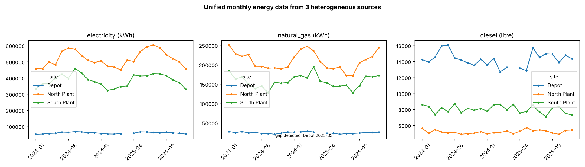

# Multi-Source Energy and Emissions ETL Pipeline

[](https://github.com/Rabbani-bot/emissions-etl-pipeline/actions/workflows/tests.yml)  

> **Design.** Three sites report the same kind of data in three incompatible ways. A ground-truth table is generated first, so the pipeline's accuracy is measured against it.



## The problem it solves
| Source | Format | Dates | Units / quirks |
|---|---|---|---|
| North Plant | CSV | dd/mm/yyyy | gas in m³; numbers stored as text with thousands separators |
| South Plant | Excel | mm/dd/yyyy | electricity in MWh; diesel in US gallons; 4 spellings of the site name |
| Depot | JSON | ISO | electricity and gas in GJ; one duplicate record; one missing month |

## Pipeline
1. **Extract:** a source-specific adapter for each file, with explicit date formats (no guessing between dd/mm and mm/dd).
2. **Transform:** canonical site names; standard carriers; unit conversion through an explicit table (MWh, GJ, m³, US gal to kWh or litres); fails loudly on unknown units, sites, carriers or negative values.
3. **Validate:** de-duplicate on site, month and carrier; build the expected site × month × carrier grid and **report gaps instead of silently filling them**.
4. **Load:** one tidy table (`data/clean/energy_monthly.csv`) plus a JSON run report.

## Measured results
| Metric | Value |
|---|---|
| Rows extracted / loaded | 214 / 213 |
| Duplicates removed | 1 |
| Gaps reported | Depot, 2025-03 (3 carriers) |
| Values matching truth within 0.1% | 213 / 213 recovered (max relative error 3×10⁻⁷, rounding only) |
| Runtime | under 0.1 s |

## Run
```bash
python3 -m unittest discover -s tests -v
python3 src/run.py
```
Requires: pandas, numpy, matplotlib, openpyxl.

**Note:** the gas calorific value (10.55 kWh/m³) is representative; use the supplier's or the national value in real work.

Author: Mohammad Rabbani – Sustainability Data Analyst & Research Consultant

## Links
- Kaggle notebook: https://www.kaggle.com/rabbani0123 (runnable copy of `notebook.ipynb`)
- Cite: see `CITATION.cff`
- Author: Mohammad Rabbani | Sustainability Data Analyst & Research Assistant

## License
MIT
